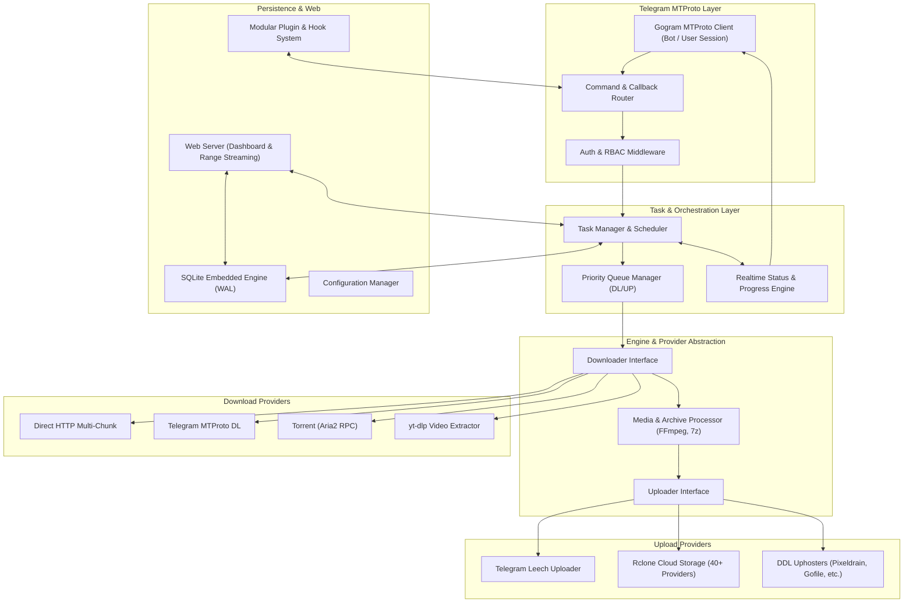

<div align="center">

# ⚡️ GoLeech

**Mirror Anything. Leech Anywhere. Powered by Go.**

[](https://golang.org)
[](https://github.com/amarnathcjd/gogram)
[](https://www.gnu.org/licenses/agpl-3.0)
[](https://github.com/GoLeech/GoLeech/actions)
[](https://www.docker.com)

A high-performance, Go-native Telegram Mirror & Leech Bot powered by Gogram MTProto, featuring multi-source downloads, cloud uploads, torrent support, and automated file management.

[Features](#-key-features) •
[Architecture](#-native-go-architecture) •
[Quick Start](#-quick-start) •
[Commands](#-commands--flags) •
[Session Setup](#-session-management) •
[Documentation](#-documentation)

---

</div>

## 🌟 Key Features

- **🚀 100% Native Go MTProto:** Built from the ground up using [Gogram](https://github.com/amarnathcjd/gogram). No Python runtime, no heavy dependencies, sub-50MB baseline RAM footprint.
- **📥 Multi-Source Downloader:**
  - **Direct HTTP/HTTPS:** Multi-part parallel chunk downloads with Range headers and resume.
  - **Telegram Media:** High-speed MTProto chunk streaming with 4 concurrent download workers.
  - **BitTorrent / Magnet Links:** Full torrent integration via Aria2 JSON-RPC daemon with seeder/leecher tracking and file selection (`-s`).
  - **yt-dlp Video Extraction:** Support for 1,000+ video hosting platforms (YouTube, Instagram, TikTok, Twitter/X).
  - **Direct Link Resolvers:** Automated link bypass for Pixeldrain, Mediafire, Buzzheavier, GitHub releases, and direct CDNs.
- **📤 Multi-Destination Uploader:**
  - **Telegram Leech:** Auto-splits files exceeding 2GB (or 4GB with Telegram Premium User sessions), video thumbnail extraction, fast-start streaming metadata, and custom captions.
  - **Rclone Cloud Storage:** Seamless uploads to 40+ cloud providers (Google Drive, OneDrive, Mega, S3, WebDAV, Dropbox).
  - **DDL File Hosts:** Direct multipart uploads to Pixeldrain, Gofile, and Buzzheavier.
- **🎛 Task & Queue Engine:**
  - Dynamic concurrency limiting (`queue_all`, `queue_download`, `queue_upload`).
  - Priority task scheduler with force-start (`-f`) flag.
  - Context-based instant cancellation with automatic disk cleanup.
  - Live anti-flood status messages with progress bars, speeds, ETA, and pagination.
- **🎬 Media & Archive Processing:**
  - Archive extraction (`-e`) and creation (`-z`) with ZipSlip protection.
  - FFmpeg screenshot thumbnail generator (`-ss`) and 30-second sample video generator (`-sv`).
  - Video and audio metadata extraction via `ffprobe`.
- **🌐 Responsive Web Dashboard & Streaming:**
  - Modern HTML5 responsive dashboard with live task cards, memory, and CPU stats.
  - HTTP Range streaming (`/stream/{gid}`) allowing direct in-browser and VLC video playback.
  - REST API for external automation and Docker `/healthz` monitoring.
- **📰 Automation & Plugins:**
  - Periodic RSS feed monitor with regex include/exclude filtering.
  - Type-safe Go plugin architecture with lifecycle hooks (`pre_task`, `post_task`).
  - Embedded pure-Go SQLite persistence (`modernc.org/sqlite`) running in WAL mode.

---

## 🏗 Native Go Architecture



---

## ⚡️ Quick Start

### 1. Using Docker (Recommended)

```bash
# Clone the repository
git clone https://github.com/GoLeech/GoLeech.git
cd GoLeech

# Configure your environment
cp .env.example .env
nano .env

# Launch with Docker Compose
docker compose up -d --build
```

### 2. Native Binary Build

```bash
# Install Go 1.24+ and system packages (ffmpeg, aria2, p7zip)
git clone https://github.com/GoLeech/GoLeech.git
cd GoLeech

# Download dependencies & compile
go mod download
go build -o bin/goleech ./cmd/goleech

# Run GoLeech
./bin/goleech
```

---

## 🔐 Session Management

GoLeech connects directly to Telegram MTProto without using unverified 3rd-party bots (such as `@GeneratorSessionRobot`).

To generate a native Gogram user session string (for **4GB Telegram Premium uploads**):

```bash
# Run the interactive session generator
go run ./cmd/login
```

Follow the prompts for your phone number, Telegram OTP code, and 2FA password. Copy the output string into your `.env`:

```env
USER_SESSION_STRING="your_generated_gogram_session_string"
```

For more details, see the [Session Generator Guide](docs/session_generator.md).

---

## 📋 Commands & Flags

### Main Commands

| Command | Aliases | Description |
|---|---|---|
| `/mirror [link/flag]` | `/m` | Download link/file and upload to cloud storage. |
| `/leech [link/flag]` | `/l` | Download link/file and upload to Telegram. |
| `/status` | `/s`, `/statusall` | Interactive live task monitor with pagination & filters. |
| `/cancel [gid]` | `/c [gid]`, `/c_<gid>` | Cancel a specific task. |
| `/cancelall [all/dl/up]` | | Cancel tasks in bulk. |
| `/usetting` | `/us` | User preferences (prefix, suffix, caption, leech mode). |
| `/bsetting` | `/bs` | Sudo bot settings and concurrency limits. |
| `/authorize [id]` | `/a` | Grant permissions to chat or user. |
| `/ping` | | Check Telegram MTProto latency. |
| `/stats` | | Check memory, goroutines, and CPU usage. |

### Supported Flags

| Flag | Argument | Description |
|---|---|---|
| `-n` | `<name>` | Rename the file / custom filename. |
| `-doc` | None | Upload media as Telegram document. |
| `-med` | None | Upload media as streamable Telegram video. |
| `-e` | None | Extract archive (`.zip`, `.rar`, `.7z`) before upload. |
| `-z` | None | Compress files into `.zip` before upload. |
| `-ss` | None | Generate video screenshot thumbnails. |
| `-sv` | None | Generate a 30-second sample video clip. |
| `-f` | None | Force start (bypass queue limits). |
| `-sp` | `<size>` | Override file split size (e.g. `2G`, `4G`). |
| `-up` | `<dest>` | Cloud destination (Rclone remote:path or uphoster). |

For full documentation, see [Command Documentation](docs/commands.md).

---

## 📚 Documentation

- [Deployment & Setup Guide](docs/setup.md)
- [Command Reference & Flags](docs/commands.md)
- [Download & Upload Providers](docs/providers.md)
- [Plugin & Extension System](docs/plugins.md)
- [MTProto Session Generator Guide](docs/session_generator.md)

---

## ⚖️ License & Attribution

GoLeech is licensed under the **GNU Affero General Public License v3.0 (AGPLv3)**. See [LICENSE](LICENSE) for details.

### Acknowledgments & Credits
- **SilentDemonSD & upstream WZML-X contributors** ([WZML-X](https://github.com/SilentDemonSD/WZML-X)) for the original Python project that inspired this native Go architecture.
- **AmarnathCJD** for the high-performance [Gogram MTProto Framework](https://github.com/amarnathcjd/gogram).
